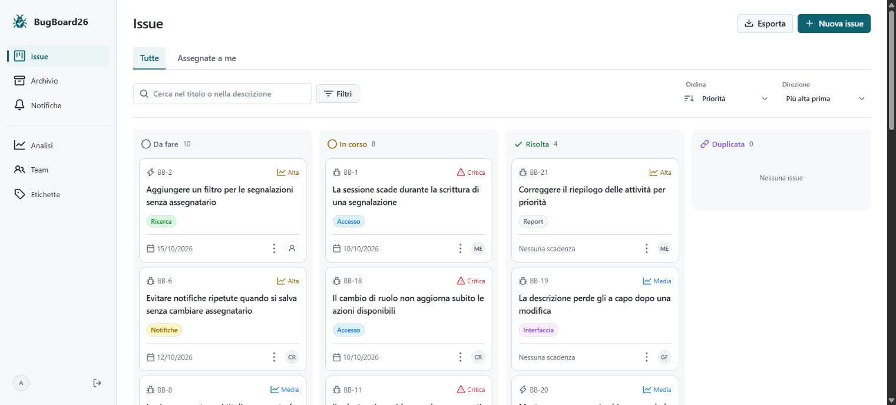
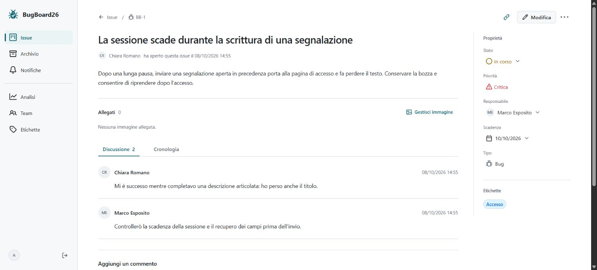
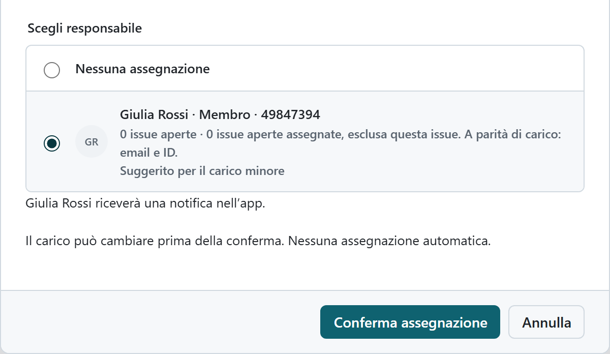

# BugBoard26

Progetto realizzato per l'esame di **Ingegneria del Software** presso l'Università degli Studi di Napoli Federico II. **Voto: 30/30.**

**Autore:** Daniele De Blasio.

BugBoard26 è un'applicazione web per gestire le segnalazioni di un progetto software: bug, richieste di chiarimento, problemi di documentazione e nuove funzionalità. Il team può assegnare il lavoro, seguirne lo stato, discutere le soluzioni e consultare lo storico delle attività.

Il backend è sviluppato in **Java 21 e Spring Boot**, il frontend in **React e TypeScript**, con **PostgreSQL** per la persistenza e **Docker Compose** per l'avvio dei servizi.

## Cosa chiedeva la traccia

La traccia richiedeva una piattaforma collaborativa per la gestione delle issue, con queste 18 funzionalità:

1. Autenticazione con email e password, amministratore iniziale e creazione degli account da parte degli amministratori.
2. Creazione di issue con titolo, descrizione e tipo: `question`, `bug`, `documentation` o `feature`. Priorità e immagine allegata erano funzionalità gradite; lo stato iniziale doveva essere `todo`.
3. Una vista riepilogativa con filtri e ordinamento.
4. Assegnazione delle segnalazioni da parte di un amministratore, notifica al responsabile e vista del lavoro assegnato.
5. Commenti per messaggi, aggiornamenti e richieste di chiarimento.
6. Cambio di stato da parte dell'assegnatario e notifica all'autore quando una segnalazione viene risolta.
7. Dashboard amministrativa con issue aperte, carico per utente e tempi medi di risoluzione.
8. Esportazione dell'elenco in un formato condivisibile; nel progetto è stato scelto **CSV**.
9. Permessi distinti: gli utenti normali modificano le issue assegnate, gli amministratori hanno accesso completo.
10. Etichette personalizzabili da associare alle segnalazioni.
11. Ricerca per parole chiave.
12. Cronologia delle modifiche con autore e data.
13. Archiviazione riservata agli amministratori e consultazione in una pagina dedicata.
14. Suggerimenti di assegnazione basati sul carico di lavoro corrente.
15. Account esterni in sola lettura per consultare issue e commenti.
16. Gestione dei duplicati, con chiusura della segnalazione duplicata.
17. Report mensili con metriche aggregate e per singolo utente.
18. Scadenze opzionali impostate dagli amministratori.

La traccia richiedeva inoltre frontend e backend indipendenti, comunicazione tramite API di rete, dati persistenti gestiti centralmente dal backend, linguaggi orientati agli oggetti e progettazione UML con strumenti CASE. Il progetto adotta API REST e diagrammi PlantUML. Docker era una scelta auspicata: qui viene usato per avviare l'intero sistema.

## Schermate dell'applicazione

Le schermate mostrano l'applicazione con dati dimostrativi e persone fittizie.

### Bacheca delle issue

Vista per stato, ricerca, filtri, priorità e accesso alle issue assegnate.



### Dettaglio di una issue

Descrizione, responsabile, scadenza, etichette, discussione e accesso alla cronologia.



### Assegnazione del lavoro

Scelta del responsabile con indicazione del carico e suggerimento del candidato.



## Documentazione tecnica

[**Apri la documentazione tecnica in PDF**](assets/BugBoard26-documentazione.pdf)

Il documento descrive requisiti e casi d'uso, architettura del sistema, design del software, persistenza, diagrammi UML e verifiche di qualità.

Il repository contiene il PDF e le schermate in `assets/`. I sorgenti e gli strumenti interni usati per preparare la documentazione e raccogliere le evidenze non fanno parte del materiale pubblicato.

## Provare il progetto

### Prerequisiti

- **Git** per clonare il repository.
- **Docker Engine con Docker Compose**, oppure Docker Desktop avviato con container Linux.
- **PowerShell 7**, con il comando `pwsh` disponibile.

Per questo avvio non occorre installare Java, Node.js o PostgreSQL sul computer: sono inclusi nelle immagini Docker.

### Avvio

Esegui questi comandi in PowerShell:

```powershell
git clone https://github.com/Daniele04-creator/BugBoard26.git
cd BugBoard26
pwsh -File scripts/start-local.ps1
```

Lo script genera la configurazione locale, compila le immagini e avvia database, backend e frontend. Al primo avvio sono necessari accesso a Internet e il tempo per scaricare le dipendenze. Attendi il messaggio di avvio completato, poi apri **[http://localhost:8088](http://localhost:8088)**.

### Primo accesso

Su un database nuovo viene creato questo amministratore dimostrativo:

| Campo | Valore |
| --- | --- |
| Email | `admin@bugboard.local` |
| Password temporanea | `BugBoard26-ChangeMe!` |

Il primo accesso richiede il cambio della password. In seguito usa la password scelta: i riavvii non ripristinano le credenziali iniziali. L'amministratore può creare altri utenti dalla sezione **Team**.

### Dati dimostrativi facoltativi

Su una nuova installazione, dopo il cambio password dell'amministratore e prima di creare altri dati, puoi caricare **6 utenti fittizi, 24 issue e 48 commenti**. Questa operazione richiede anche il **JDK 21** sul computer.

Su Windows, dalla cartella principale del progetto:

```powershell
cd backend
.\mvnw.cmd -B -ntp -DskipTests package
cd ..
pwsh -File scripts/prepare-demo.ps1
```

Su Linux e macOS usa `./mvnw` al posto di `.\mvnw.cmd`.

Il caricamento richiede il profilo locale `demo`, già previsto dalla configurazione iniziale. La password degli utenti fittizi viene salvata in un file privato esterno al repository; lo script ne indica il percorso. Un secondo caricamento non crea doppioni; il primo viene rifiutato se sono già presenti dati estranei al caricamento.

### Arrestare e riavviare

Dalla cartella principale:

```powershell
docker compose --env-file deploy/.env -f deploy/compose.yaml down
```

Il database resta nel volume Docker. Per riavviare:

```powershell
pwsh -File scripts/start-local.ps1
```

Le porte predefinite sono `8088` per l'interfaccia, `8080` per le API e `55433` per PostgreSQL. Se una porta è occupata, lo script lo segnala: modifica rispettivamente `FRONTEND_PORT`, `SERVER_PORT` o `DB_HOST_PORT` in `deploy/.env`. Se cambi la porta frontend, aggiorna anche `PUBLIC_BASE_URL` e l'origine corrispondente in `CORS_ALLOWED_ORIGINS`. Questo file contiene segreti locali ed è escluso da Git.

## Test automatici

Il repository include test del backend, del frontend e dei flussi nel browser, oltre ai controlli di qualità eseguiti da GitHub Actions. Per eseguirli localmente servono **JDK 21**, **Node.js 24** e Docker operativo.

Dalla cartella principale, su Windows:

```powershell
cd backend
.\mvnw.cmd -B -ntp verify
cd ../frontend
npm ci
npm run lint
npm test
npm run build
cd ..
```

Su Linux e macOS usa `./mvnw` al posto di `.\mvnw.cmd`.

Per i test nel browser, avvia l'istanza isolata e usa i dati di collaudo:

```powershell
pwsh -File scripts/start-local.ps1 -Test
cd frontend
npx playwright install chromium firefox
$env:E2E_BASE_URL = 'http://localhost:8089'
npm run test:e2e
cd ..
```

I test browser creano e modificano dati nell'istanza isolata. Per arrestarla conservando il suo database:

```powershell
docker compose --env-file deploy/.env -f deploy/compose.yaml -f deploy/compose.test.yaml down
```
